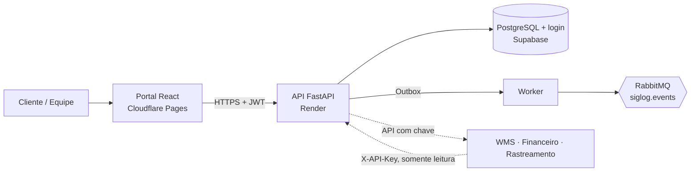

# SIG-Log Customer — CRM, SAC & Portal do Cliente

**Squad 06 · Análise de Sistemas II · Demoday 30/11/2026** · Release [v1.0.0](https://github.com/Anthonywilliam0102/siglog-customer/releases/tag/v1.0.0)

## Quem somos
Equipe **Student Help**: Anthony William, Edson Guilherme, Fellipe José e Juan Pablo.

## O que este módulo faz
Na plataforma logística **SIG-Log**, o Squad 06 é a **porta de entrada do cliente**: ele cota o frete, cria o pedido, acompanha o rastreamento, fala com o atendimento (SAC), registra sinistros (avaria ou extravio) e avalia a entrega. A equipe de atendimento tem uma fila própria, com prazo de resposta (SLA). O módulo conversa com os outros squads por **eventos** (RabbitMQ) e por **API** (WMS, Financeiro, Rastreamento).

## Acesse o sistema (já está no ar)
| O quê | Endereço |
|---|---|
| **Portal** | https://siglog-customer.pages.dev |
| Portal (reserva) | https://anthonywilliam0102.github.io/siglog-customer/ |
| API (documentação interativa) | https://siglog-customer-api.onrender.com/docs |

> **Primeiro acesso:** a API roda num plano gratuito que hiberna. Se o login ou a primeira tela demorarem, é só aguardar cerca de 1 minuto (abra antes o endereço `…/health` da API para acordá-la).

**Como entrar:** na tela de login, use **Criar conta** (um e-mail fictício serve; a senha precisa de 8 caracteres) ou **Entrar com GitHub**. Contas novas têm o perfil de **cliente**. O perfil de **equipe (atendente)**, que vê a fila de atendimento e as configurações, é fornecido pelo squad ao professor por canal seguro; não fica neste repositório.

## Roteiro para conhecer o projeto (cerca de 10 minutos)
**Como cliente**
1. **Crie a conta** e preencha o cadastro (CPF ou CNPJ válidos; os dados são fictícios).
2. **Nova cotação:** clique nos campos de origem e destino e escolha uma capital da lista. Informe peso e volume e veja o valor estimado.
3. **Confirme o pedido.** Na tela do pedido aparecem o **rastreamento** e o bloco **"Informações de outros squads"** (separação no WMS e cobrança no Financeiro).
4. **Fale conosco** (botão com o fone de ouvido, no canto da tela): converse com o assistente automático, que consulta os dados reais do pedido. Se ele não resolver, abra o chamado. A conversa continua em formato de chat e recebe uma resposta automática com o prazo.
5. **Registrar sinistro** (no menu do usuário ou na tela inicial) e, depois da entrega, **avalie** a entrega.
6. Clique na **bolinha do usuário** (canto superior direito): *Meus pedidos, chamados, sinistros, Minha conta* e **Integrações**, onde se vê o estado da ligação com cada squad.

**Como equipe (com as credenciais do squad)**
7. **Atendimento:** fila de chamados com SLA; responda e marque como resolvido.
8. **Pedidos:** avance o status (criado, em separação, em transporte, entregue). As regras de transição estão em [docs/02_requirements.md](docs/02_requirements.md).
9. **Integrações:** uma aba por squad, onde se cadastra a URL e a **chave de API** do outro squad (guardada cifrada; nunca volta ao navegador) e se **testa a conexão**. A aba **Nossa API** gera chaves para os outros squads consultarem os nossos pedidos (somente leitura).
10. **API:** em `/docs` (link acima) está o contrato completo, para testar as rotas.

## O que é real e o que é simulado
| Real | Simulado (sempre marcado "simulado" na tela) |
|---|---|
| Login, cadastro, cotação, pedidos, chamados com chat, sinistros, avaliações, fila do atendimento, eventos (Outbox + RabbitMQ), integrações configuráveis, chaves de API | Dados do WMS, do Financeiro e do Rastreamento **enquanto os outros squads não conectarem a API deles**. Quando a URL e a chave são cadastradas, o portal passa a chamar a API real |

O assistente do "Fale conosco" funciona por regras fixas (não é inteligência artificial) e consulta o pedido do cliente. Os contratos de WMS e Financeiro são uma **proposta nossa**, ainda não confirmada pelos squads ([contracts/](contracts/)).

## Como está montado

Decisões principais: gravar o evento na mesma transação do negócio (Outbox) e entregá-lo depois, para a resposta não depender do broker; cliente só vê os próprios dados (RN02); regras de status do pedido (RN07). Detalhes em [docs/06_architecture.md](docs/06_architecture.md) e nos ADRs em [docs/adr/](docs/adr/).

## Onde ler (ordem sugerida)
| Para entender… | Leia |
|---|---|
| O problema e o produto | [docs/01_product_vision.md](docs/01_product_vision.md), [03_personas.md](docs/03_personas.md), [02_requirements.md](docs/02_requirements.md) |
| O desenho (DDD e arquitetura) | [docs/04_ddd.md](docs/04_ddd.md), [05_context_map.md](docs/05_context_map.md), [06_architecture.md](docs/06_architecture.md) |
| A API e os eventos | [openapi.yaml](openapi.yaml), [docs/07_api_contract.md](docs/07_api_contract.md), [08_events.md](docs/08_events.md) |
| Banco de dados | [docs/09_database.md](docs/09_database.md), [migrations/](migrations/) |
| Integração com os outros squads | [docs/20_integracao_squads.md](docs/20_integracao_squads.md), [contracts/](contracts/) |
| Qualidade, carga e segurança | [docs/12_atam.md](docs/12_atam.md), [13_load_test.md](docs/13_load_test.md), [11_security.md](docs/11_security.md), [21_seguranca.md](docs/21_seguranca.md) |
| Observabilidade | [docs/10_observability.md](docs/10_observability.md), [monitoring/](monitoring/) |
| UX e roteiro do Demoday | [docs/16_ux_csd_empatia.md](docs/16_ux_csd_empatia.md), [14_demoday_roteiro.md](docs/14_demoday_roteiro.md) |
| Progresso e pendências | [docs/00_checklist.md](docs/00_checklist.md) |

## Qualidade em números
- **138 testes automatizados** (unitários, integração, contrato e segurança) e CI a cada alteração, com varredura de vulnerabilidades (Trivy) e imagem publicada no GHCR.
- **Carga (K6, ambiente local):** 100 req/s com p95 de 415 ms e 0,19% de erro. Acima disso a API recusa rápido (503) em vez de travar. Detalhes e limitações em [docs/13_load_test.md](docs/13_load_test.md).
- **Segurança:** rodada de ataque simulado com 4 correções feitas e documentadas em [docs/21_seguranca.md](docs/21_seguranca.md).

## Stack
Python 3.12 + FastAPI · SQLAlchemy + Alembic · PostgreSQL (Supabase) · RabbitMQ · React + Vite · Docker Compose · GitHub Actions + GHCR · OpenTelemetry, Prometheus, Grafana, Jaeger · Trivy · K6.

<details>
<summary><b>Rodar na própria máquina (opcional, para quem quiser reproduzir)</b></summary>

```bash
cp .env.example .env
docker compose up -d --build        # API, banco, worker, RabbitMQ, Prometheus, Grafana e Jaeger
```
| Serviço | Endereço |
|---|---|
| API (Swagger) | http://localhost:8000/docs |
| RabbitMQ (UI) | http://localhost:15672 |
| Grafana · Prometheus · Jaeger | http://localhost:3000 · :9090 · :16686 |

```bash
cd frontend && cp .env.example .env.local && npm install && npm run dev   # portal em http://localhost:5173
python -m venv .venv && source .venv/bin/activate && pip install -r requirements-dev.txt && ruff check . && pytest
```
Detalhes do portal em [frontend/README.md](frontend/README.md). Para gerar um token de desenvolvimento: `python scripts/gen_token.py <usuario> <cliente|atendente|gestor>`.
</details>

## Segurança e dados
Somente **dados fictícios**. Nunca versione `.env` nem credenciais; os segredos de CI ficam em *GitHub Secrets*.
